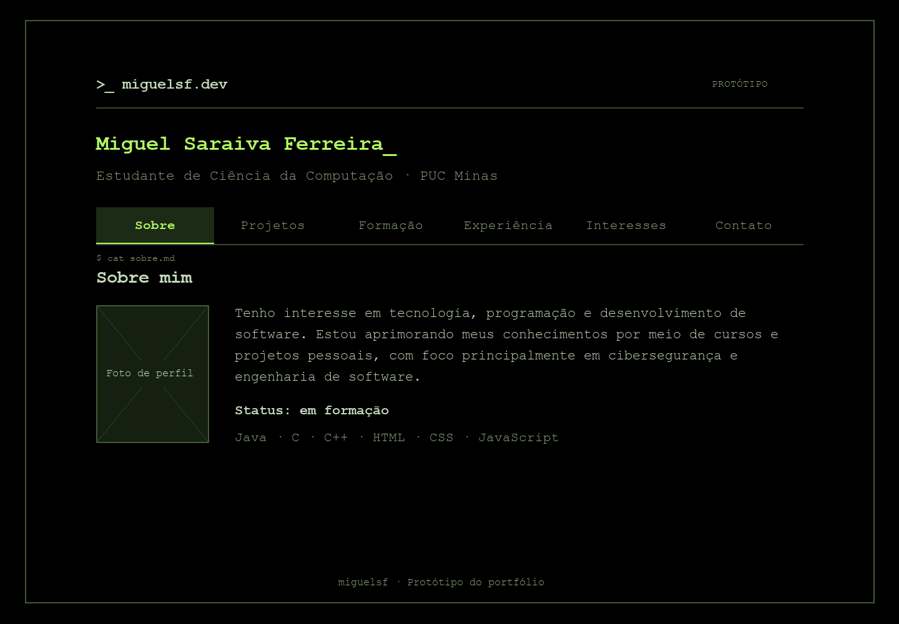
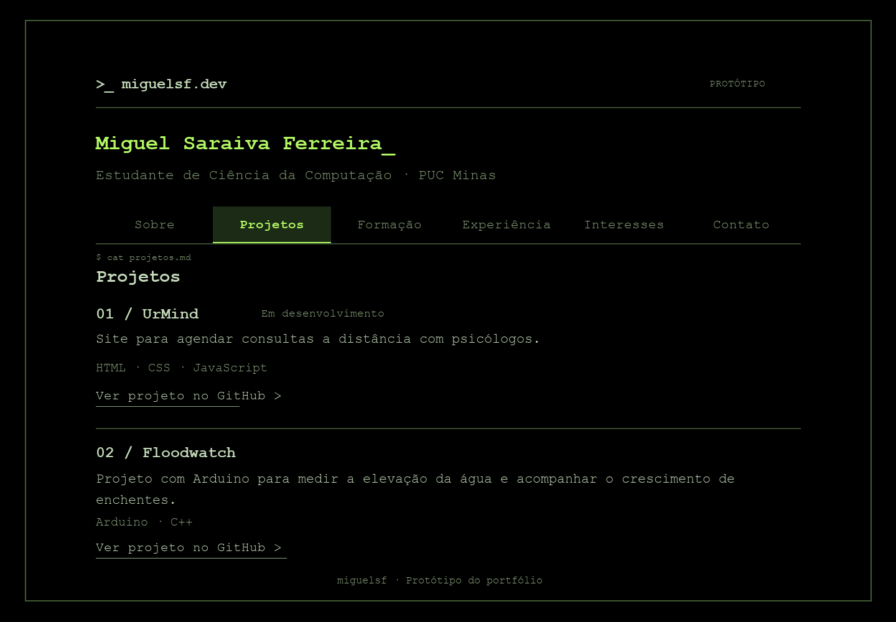
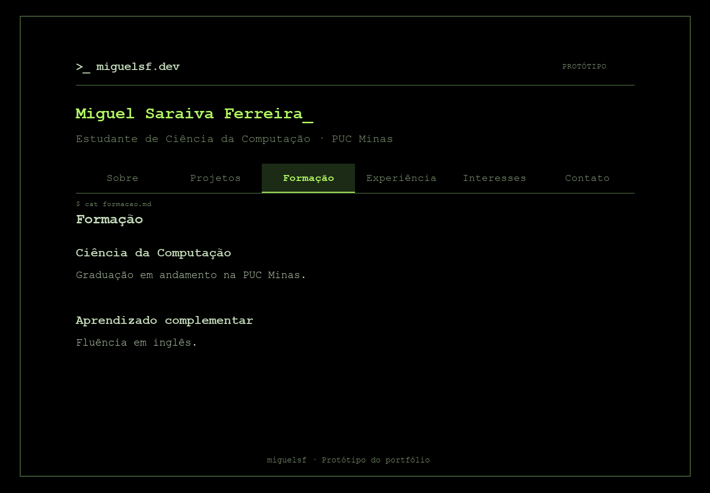
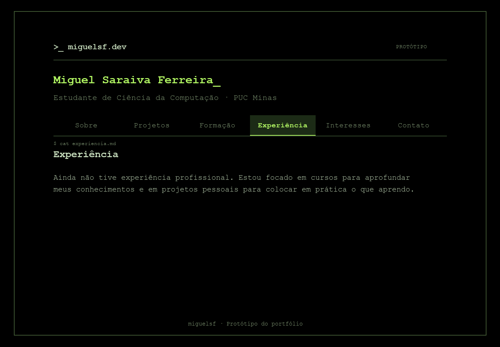
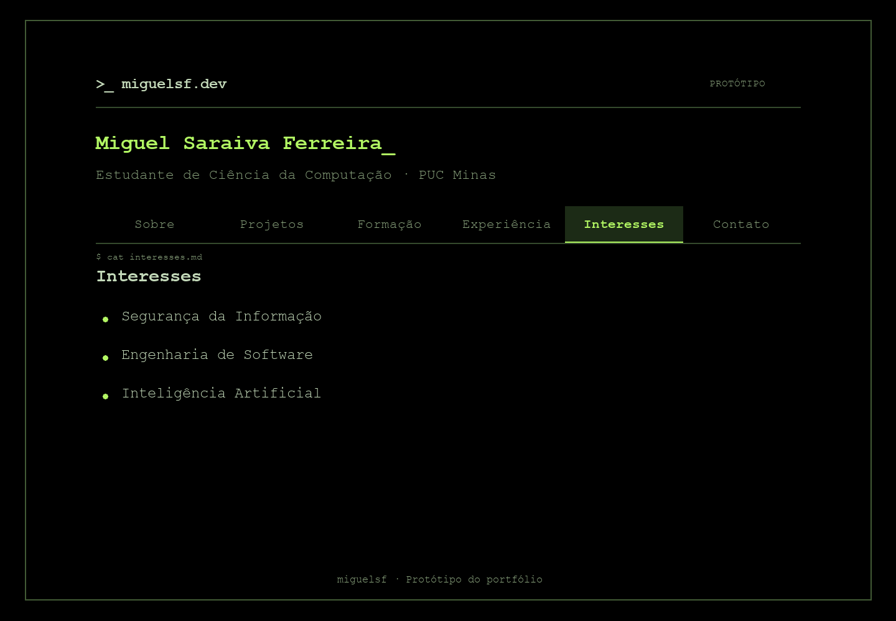
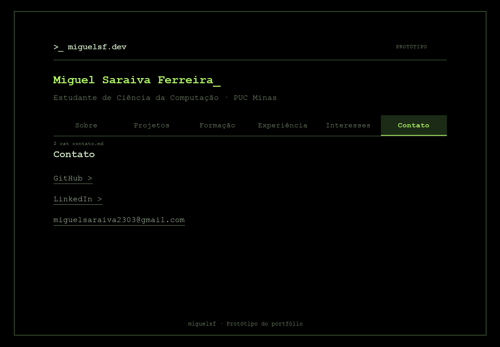

# Protótipo do portfólio — miguelsf.dev

## Descrição do projeto

O projeto consiste em um portfólio pessoal de Miguel Saraiva Ferreira, estudante de Ciência da Computação na PUC Minas. Seu objetivo é apresentar a trajetória acadêmica, os projetos desenvolvidos, os interesses profissionais e os canais de contato.

## Tecnologias

| Tecnologia | Finalidade |
| --- | --- |
| HTML5 | Estruturar as páginas, seções e conteúdo do portfólio |
| CSS3 | Definir cores, espaçamento, tipografia e adaptação para diferentes tamanhos de tela |
| JavaScript | Controlar a navegação entre as abas e exibir a seção selecionada |
| Git e GitHub | Versionar os arquivos e manter o repositório do projeto |

O protótipo utiliza HTML, CSS e JavaScript nativos, sem bibliotecas ou frameworks externos. Não depende de servidor de aplicação ou banco de dados.

## Estrutura inicial do site

A página principal reúne seis abas:

| Aba | Conteúdo planejado |
| --- | --- |
| Sobre | Apresentação pessoal, espaço para foto, habilidades e status de formação |
| Projetos | UrMind e Floodwatch, com descrições, tecnologias e links para seus repositórios |
| Formação | Graduação em Ciência da Computação na PUC Minas e fluência em inglês |
| Experiência | Situação profissional atual e dedicação a cursos e projetos pessoais |
| Interesses | Segurança da Informação, Engenharia de Software e Inteligência Artificial |
| Contato | GitHub, LinkedIn e e-mail |

O cabeçalho apresenta a identificação `miguelsf.dev`, seguido do nome e da formação. A navegação por abas exibe uma seção por vez. O rodapé identifica o portfólio como protótipo.

## Imagens dos protótipos

Os wireframes abaixo apresentam o planejamento das telas para computador, com fundo preto e elementos inspirados em terminal. São referências de layout; a implementação simplificada pode apresentar diferenças de estilo.

### 1. Sobre

Apresentação pessoal, espaço reservado para foto e habilidades.

### 2. Projetos

Apresentação dos projetos UrMind e Floodwatch, com tecnologias e links para o GitHub.

### 3. Formação

Informações sobre a graduação e o aprendizado complementar.

### 4. Experiência

Descrição do momento profissional e do foco em cursos e projetos pessoais.

### 5. Interesses

Áreas de interesse para estudo e desenvolvimento profissional.

### 6. Contato

Canais para entrar em contato e acessar os perfis profissionais.

